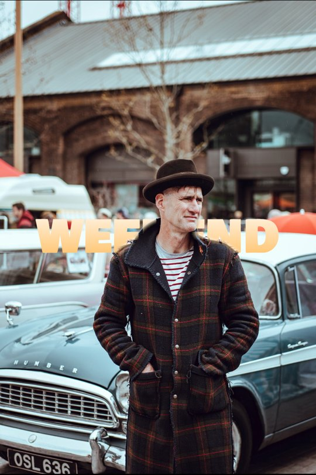
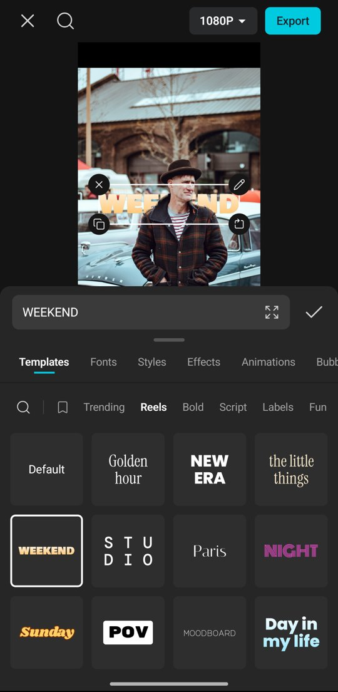
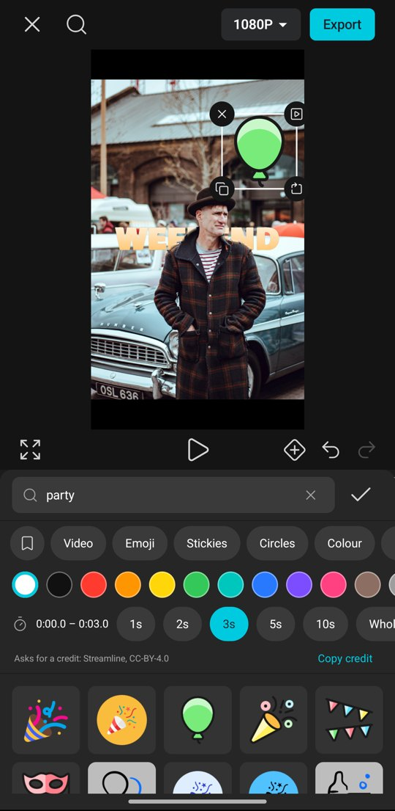
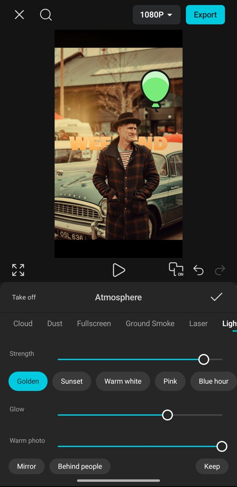
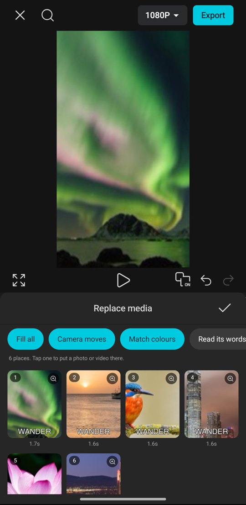
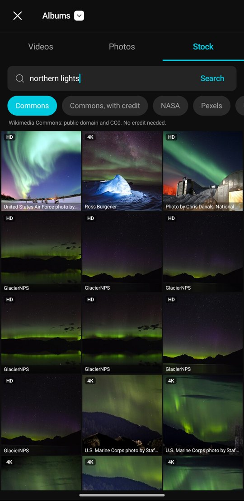
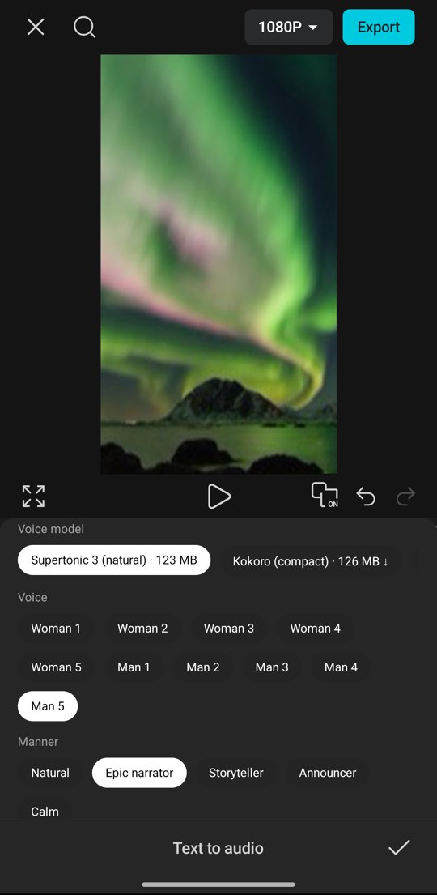

> **CapCraft Forge is an unofficial, modified build of [CapCraft for Android](https://github.com/artcraft-android/capcraft-android)**
> by the ArtCraft Team, built on [Concat](https://github.com/jub0t/Concat) by Jareer Abdullah and the Concat contributors.
> All credit for the original work goes to them. They do not maintain or endorse this build; please report its problems here.
> See [CREDITS.md](CREDITS.md) and [CHANGELOG.md](CHANGELOG.md). Not affiliated with ByteDance or CapCut.

<p align="center">
  
</p>

<h1 align="center">CapCraft Forge</h1>

<p align="center">
  <b>An open-source video editor for Android.</b><br>
  Many credits to the original maintainers, <a href="https://github.com/jub0t">jub0t</a> and the Concat contributors.
</p>

<p align="center">
  <a href="https://github.com/praveenkrishna16n-sys/capcraft-forge/releases/latest"></a>
</p>

<p align="center">
  
  
  
  
  
  
</p>

<p align="center">
  <a href="#made-for-reels">Made for reels</a> ·
  <a href="#what-capcraft-forge-adds">What Forge adds</a> ·
  <a href="#still-to-do">Still to do</a> ·
  <a href="#building-instructions">Building</a>
</p>

<br>

<table align="center">
<tr>
<td align="center"></td>
<td align="center"></td>
</tr>
<tr>
<td align="center"><sub>Home: start a video or a photo, then your projects</sub></td>
<td align="center"><sub>The editor: preview, timeline and tools</sub></td>
</tr>
</table>

<br>

## Made for reels

<table align="center">
<tr>
<td align="center"></td>
<td align="center"></td>
<td align="center"></td>
</tr>
<tr>
<td align="center"><sub>Titles behind the person: the people cut out on the phone</sub></td>
<td align="center"><sub>Reel title styles in modern fonts</sub></td>
<td align="center"><sub>20,236 graphics, found by words without the internet</sub></td>
</tr>
<tr>
<td align="center"></td>
<td align="center"></td>
<td align="center"></td>
</tr>
<tr>
<td align="center"><sub>Light in the colour you choose, its black gone</sub></td>
<td align="center"><sub>Reel to template: cuts, moves, words and sound read on the phone</sub></td>
<td align="center"><sub>HD stock photos searched on the import page</sub></td>
</tr>
<tr>
<td align="center"></td>
<td align="center"></td>
</tr>
<tr>
<td align="center"><sub>An epic narrator, and voices that say words as they are meant</sub></td>
<td align="center"><sub>Color match: the colours of another frame or photo</sub></td>
</tr>
</table>

<br>

<p align="center"><sub>Every picture here is a screenshot of the app. The photographs in them are CC0 or public domain; see <a href="CREDITS.md#photographs-and-film">CREDITS.md</a>.</sub></p>

<br>

## What CapCraft Forge adds

Everything in [CapCraft for Android](https://github.com/artcraft-android/capcraft-android) is here. On top of it, this build
adds the following; [CHANGELOG.md](CHANGELOG.md) dates each change.

<sub>✅ tested on a phone · 🧪 built, phone test to come</sub>

### Playback and speed

| Feature | |
|---|---|
| 4K and ten-bit video played from a proxy (egagofur's pull request #29), from its scrub copy until the proxy is ready | ✅ |
| Smoother playback: frames made ahead, an even clock, less copying | ✅ |
| A new project takes its first video's frame rate, and so does its export; an export begins with a keyframe | ✅ |
| Preview quality: Full, Half or Low, for slower phones | ✅ |
| A small app: 43 MB, from 116 (one ONNX Runtime, a trimmed FFmpeg, packed libraries, fonts downloaded when wanted) and a quicker start | ✅ |

### Editing

| Feature | |
|---|---|
| Opacity, masks and volume follow keyframes; Graphs shape mask keyframes too | ✅ |
| A duplicate keeps every change; stickers can be duplicated; the preview follows a picture being moved | ✅ |
| Groups of clips that move together, and compound clips | ✅ |
| Timing: when a graphic, title or overlay comes on and goes, to a tenth of a second | ✅ |
| A video can take a photo's place | ✅ |

### Colour and light

| Feature | |
|---|---|
| Color match: a clip takes the colours of another frame or a photo | ✅ |
| Exposure in Adjust | ✅ |
| Light people: people who are underexposed lit, the rest left alone; a face in shadow given a soft light of its own, dark clothes kept dark | ✅ |
| Atmosphere: smoke, mist, light rays and dust from a folder of your own overlays, each laid as its kind is, behind people if wanted | ✅ |
| Atmosphere's light in a colour of your choice (golden, sunset, warm white, pink, blue hour or its own), with glow and warmth; an overlay's black taken away so it leaves the photo as it was | ✅ |

### People and things, on the phone

| Feature | |
|---|---|
| Remove objects: people and things in a photo found, removed with the picture filled in, or put in an overlay | ✅ |
| Fine cutout: bare branches and other fine things cut from the sky | ✅ |
| Auto highlight: a video's liveliest moments kept | ✅ |

### Captions, text and voice

| Feature | |
|---|---|
| Filler words ("um", "uh") found and cut; caption keywords in colour; caption emojis; captions with their English under them | ✅ |
| The colour emoji of newer phones in titles | ✅ |
| Reel title styles and twelve modern faces (Instrument Serif, Poppins, Shrikhand, Monoton, DM Mono and more) | ✅ |
| Titles, graphics and stickers behind the person in the picture | ✅ |
| Modern animations: smooth rise, focus in, snap, slam, swipe and their outs, on a reel's easing | ✅ |
| Supertonic 3 voices that say "live" in "broadcast live" and "how you live" as meant, in 31 languages | ✅ |
| Reading manners: epic narrator, storyteller, announcer, calm | ✅ |
| My voice: text read in your own voice, recorded saying it may be copied | 🧪 |
| 20 more fonts, downloaded when wanted | ✅ |

### Graphics, photos and sound

| Feature | |
|---|---|
| 20,236 graphics (emoji, stickers, icons, flags, logos and shapes for video) kept in the app and found by words without the internet, with keyframes, animations and effects | ✅ |
| Stock photos, full HD or better, searched on the import page: Wikimedia Commons and NASA | ✅ |
| Unsplash among the stock photos, with a key of your own | 🧪 |
| People grey or tinted (anger red rising over the clip), and Invert on Remove background | 🧪 |
| Atmosphere light in 3D: the photo's depth read on the phone, shadows traced from the light (faded where the photo is lit already, in the light's strength and colour), the people lit from its side; or flat, in 2D | 🧪 |
| Stock videos on the import page, narrowed to a language of India: public domain films (1965 and before) on the Internet Archive, and Commons. Only what may be changed and used commercially | 🧪 |
| Sound FX from your own folders of sounds | ✅ |

### Projects and templates

| Feature | |
|---|---|
| A project as a file, and a file opened as a project; a project used as a template | ✅ |
| Reel to template: a finished video's cuts, transitions, moves, shake, flashes, framing and sound read on the phone, for your own photos and videos to go in, in its colours | ✅ |
| Reel to template reads the words it shows as titles, and parts its voice from its music | ✅ |
| Built-in templates: fifteen reel looks with places for your own photos and videos, titles to type over, sample photos and music | ✅ |
| Screen recording, a Home screen widget, and live photos in and out | ✅ |

### Export

| Feature | |
|---|---|
| HDR export in ten-bit HEVC | ✅ |
| Photo and live photo export from any project | ✅ |

## Still to do

| Feature | Notes |
|---|---|
| Teeth whitening and a skin brush | Needs a face model |
| Face and body reshaping, makeup, eye contact correction | Needs face and body tracking |
| Separate instruments | Only the voice can be parted today |
| Remove objects and Light people on video | Photos only now; freeze a frame first |
| A music library, and effects and templates to download | Needs a host for the files |
| A shelf of ready-made templates | Needs original content |
| Reel to template: speed ramps, freeze frames and how titles come in | Its separate layers and exact fonts cannot be had back from one video |
| Voices made from a sample on the phone (Chatterbox) | Desktop only today |
| YouTube and Klipy among the stock videos | Their API terms forbid downloading what they host, or keeping copies of it |
| Generative AI, cloud storage, accounts | Not planned: CapCraft is a local app |

<br>

## Building Instructions
*One Gradle command builds the app: it compiles the Rust engine with [cargo-ndk](https://github.com/bbqsrc/cargo-ndk) and generates the Kotlin bindings. FFmpeg and sherpa-onnx are fetched and built first, once.*

* Clone this repository
* Make sure you have at least 10 GB of free disk space
* In `src`, with `ANDROID_HOME` pointing at your Android SDK:
  ```
  scripts/ffmpeg-mobile.sh aarch64-linux-android
  scripts/sherpa-mobile.sh aarch64-linux-android
  eval "$(scripts/mobile-env.sh aarch64-linux-android)"
  ```
* then enter `src/crates/capcraft-android/android` and run `./gradlew assembleRelease`.

Build time dependencies:

<details>
  <summary>required tools</summary>

  ```
      Linux or macOS (on Windows, WSL)
      rustup (it installs the Rust release rust-toolchain.toml names)
      rustup target add aarch64-linux-android
      cargo install cargo-ndk --version 4.1.2 --locked
      Android SDK (API 37) and NDK 29.0.14206865
      JDK 17 or newer
      cmake, make, clang (libclang-dev), curl
  ```
</details>

*Builds are only tested in WSL Ubuntu on Windows 11.*

<br>

## License

[AGPL-3.0-or-later](LICENSE). CapCraft Forge is not affiliated with, endorsed by or connected to ByteDance or CapCut.

<br>

## Misc info for myself

Try to use [semantic commit](https://kapeli.com/cheat_sheets/Semantic_Commits.docset/Contents/Resources/Documents/index)
messages. Use `feat:` / `fix:` / `chore:` / `docs:` / etc.
