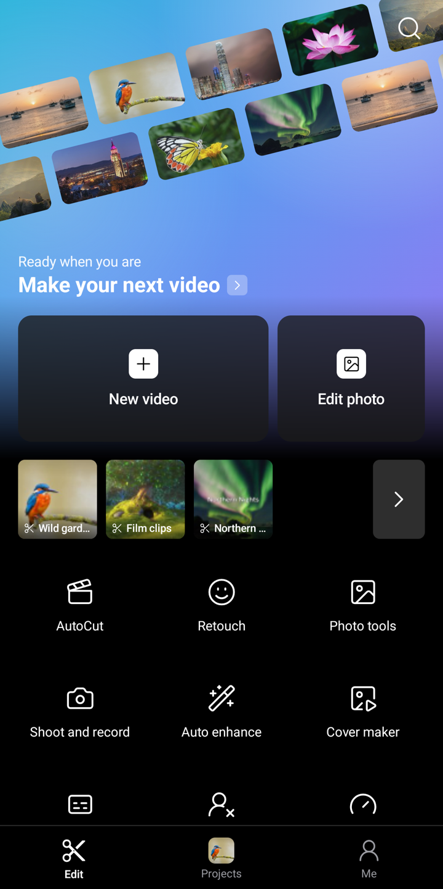
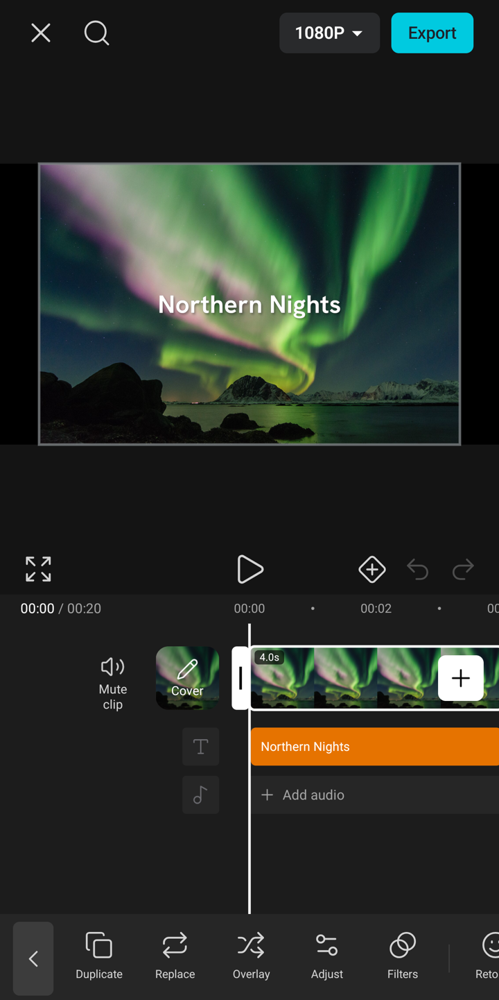
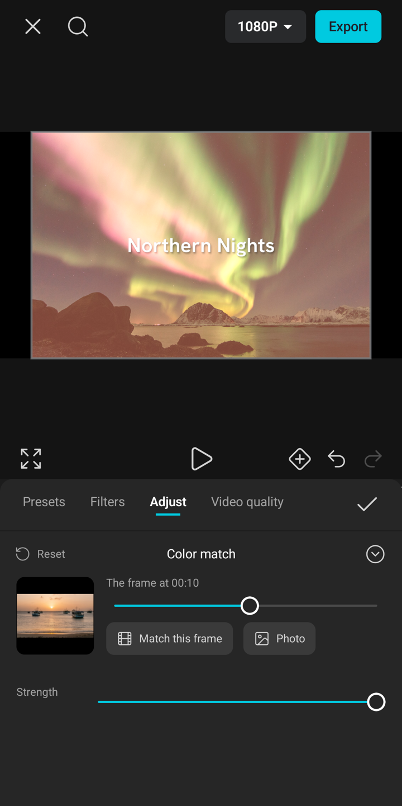
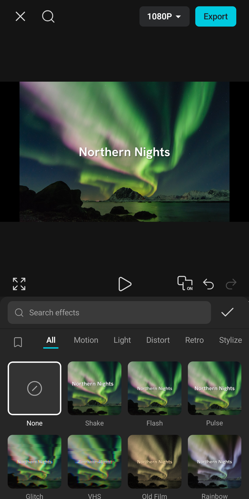
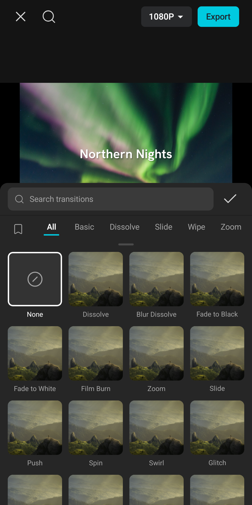
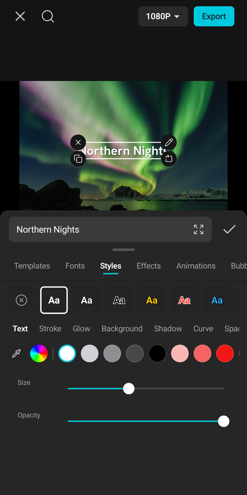
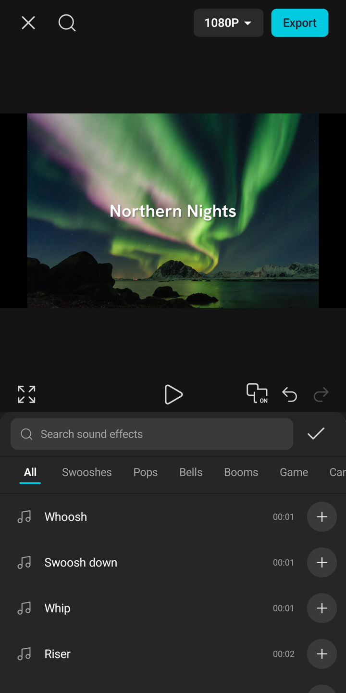
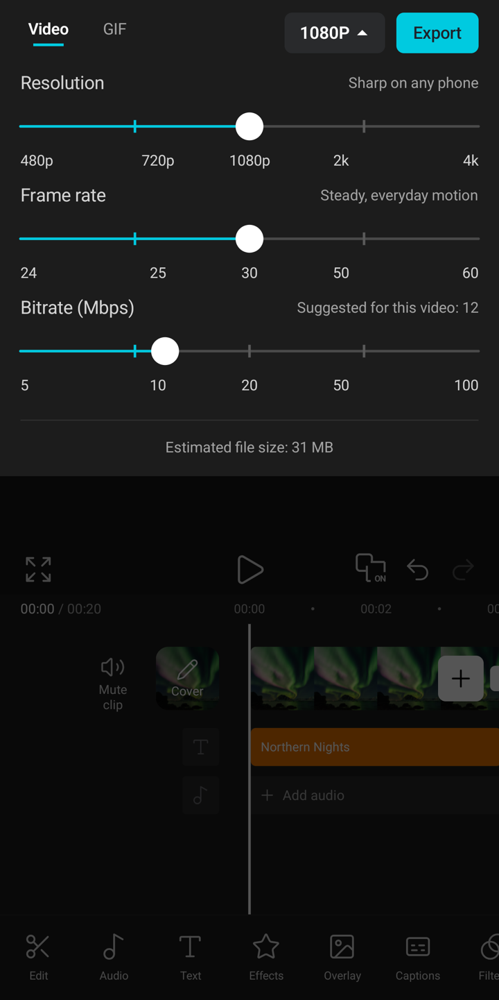

> **CapCraft Forge is an unofficial, modified build of [CapCraft for Android](https://github.com/artcraft-android/capcraft-android)**
> by the ArtCraft Team, built on [Concat](https://github.com/jub0t/Concat) by Jareer Abdullah and the Concat contributors.
> All credit for the original work goes to them. They do not maintain or endorse this build; please report its problems here.
> See [CREDITS.md](CREDITS.md) and [CHANGELOG.md](CHANGELOG.md). Not affiliated with ByteDance or CapCut.

<p align="center">
  
</p>

<h1 align="center">CapCraft Forge</h1>

<p align="center">
  <b>An open-source video editor for Android.</b><br>
  Many credits to the original maintainers, <a href="https://github.com/jub0t">jub0t</a> and the Concat contributors.
</p>

<p align="center">
  
  
  
  
  
  
</p>

<p align="center">
  <a href="#editing">Editing</a> ·
  <a href="#color">Color</a> ·
  <a href="#filters-effects-and-transitions">Filters, effects &amp; transitions</a> ·
  <a href="#text-and-stickers">Text &amp; stickers</a> ·
  <a href="#sound-and-export">Sound &amp; export</a> ·
  <a href="#what-capcraft-forge-adds">What Forge adds</a> ·
  <a href="#still-to-do">Still to do</a> ·
  <a href="#building-instructions">Building</a>
</p>

<br>

<table align="center">
<tr>
<td align="center"></td>
<td align="center"></td>
</tr>
<tr>
<td align="center"><sub>Home: start a video or a photo, then your projects</sub></td>
<td align="center"><sub>The editor: preview, timeline and tools</sub></td>
</tr>
</table>

<br>

## Editing

<table align="center">
<tr>
<td align="center"></td>
<td align="center"></td>
<td align="center"></td>
</tr>
<tr>
<td align="center"><sub>A clip selected: trim, duplicate, replace, adjust and more</sub></td>
<td align="center"><sub>Masks, moved and sized on the preview</sub></td>
<td align="center"><sub>Video clips on the timeline</sub></td>
</tr>
</table>

<br>

## Color

<table align="center">
<tr>
<td align="center"></td>
<td align="center"></td>
</tr>
<tr>
<td align="center"><sub>Adjust: smart tools and sliders</sub></td>
<td align="center"><sub>Color match: take the colors of another frame or a photo</sub></td>
</tr>
</table>

<br>

## Filters, effects and transitions

<table align="center">
<tr>
<td align="center"></td>
<td align="center"></td>
<td align="center"></td>
</tr>
<tr>
<td align="center"><sub>80+ filters, previewed on the clip</sub></td>
<td align="center"><sub>Video effects, on a clip or on a row of their own</sub></td>
<td align="center"><sub>Transitions, shown on your own clips</sub></td>
</tr>
</table>

<br>

## Text and stickers

<table align="center">
<tr>
<td align="center"></td>
<td align="center"></td>
</tr>
<tr>
<td align="center"><sub>Text: templates, fonts, styles, effects, animations and bubbles</sub></td>
<td align="center"><sub>Stickers, labels, shapes and doodles</sub></td>
</tr>
</table>

<br>

## Sound and export

<table align="center">
<tr>
<td align="center"></td>
<td align="center"></td>
</tr>
<tr>
<td align="center"><sub>Sound effects, made by the app</sub></td>
<td align="center"><sub>Export at 480p to 4K, 24 to 60 fps, or as a GIF or photo</sub></td>
</tr>
</table>

<br>

<p align="center"><sub>Every picture here is a screenshot of the app. The photographs in them are CC0; Big Buck Bunny is © Blender Foundation, CC BY 3.0. See <a href="CREDITS.md#photographs-and-film">CREDITS.md</a>.</sub></p>

<br>

## What CapCraft Forge adds

Everything in [CapCraft for Android](https://github.com/artcraft-android/capcraft-android) is here. On top of it, this build
adds the following; [CHANGELOG.md](CHANGELOG.md) dates each change.

<sub>✅ tested on a phone · 🧪 built, phone test to come</sub>

### Playback and speed

| Feature | |
|---|---|
| 4K and ten-bit video played from a proxy (egagofur's pull request #29), from its scrub copy until the proxy is ready | ✅ |
| Smoother playback: frames made ahead, an even clock, less copying | ✅ |
| A new project takes its first video's frame rate, and so does its export; an export begins with a keyframe | ✅ |
| Preview quality: Full, Half or Low, for slower phones | ✅ |
| A small app: 43 MB, from 116 (one ONNX Runtime, a trimmed FFmpeg, packed libraries, fonts downloaded when wanted) and a quicker start | ✅ |

### Editing

| Feature | |
|---|---|
| Opacity, masks and volume follow keyframes; Graphs shape mask keyframes too | ✅ |
| A duplicate keeps every change; stickers can be duplicated; the preview follows a picture being moved | ✅ |
| Groups of clips that move together, and compound clips | ✅ |
| Timing: when a graphic, title or overlay comes on and goes, to a tenth of a second | ✅ |
| A video can take a photo's place | ✅ |

### Colour and light

| Feature | |
|---|---|
| Color match: a clip takes the colours of another frame or a photo | ✅ |
| Exposure in Adjust | ✅ |
| Light people: people who are underexposed lit, the rest left alone | ✅ |
| Atmosphere: smoke, mist, light rays and dust from a folder of your own overlays, each laid as its kind is, behind people if wanted | ✅ |
| Atmosphere's light in a colour of your choice (golden, sunset, warm white, pink, blue hour or its own), with glow and warmth; an overlay's black taken away so it leaves the photo as it was | ✅ |

### People and things, on the phone

| Feature | |
|---|---|
| Remove objects: people and things in a photo found, removed with the picture filled in, or put in an overlay | ✅ |
| Fine cutout: bare branches and other fine things cut from the sky | ✅ |
| Auto highlight: a video's liveliest moments kept | ✅ |

### Captions, text and voice

| Feature | |
|---|---|
| Filler words ("um", "uh") found and cut; caption keywords in colour; caption emojis; captions with their English under them | ✅ |
| The colour emoji of newer phones in titles | ✅ |
| Supertonic 3 voices that say "live" in "broadcast live" and "how you live" as meant, in 31 languages | ✅ |
| Reading manners: epic narrator, storyteller, announcer, calm | ✅ |
| My voice: text read in your own voice, recorded saying it may be copied | 🧪 |
| 20 more fonts, downloaded when wanted | ✅ |

### Graphics, photos and sound

| Feature | |
|---|---|
| 20,236 graphics (emoji, stickers, icons, flags, logos and shapes for video) kept in the app and found by words without the internet | ✅ |
| Stock photos, full HD or better, searched on the import page: Wikimedia Commons and NASA | ✅ |
| Pexels and Unsplash among the stock photos, with a key of your own | 🧪 |
| Sound FX from your own folders of sounds | ✅ |

### Projects and templates

| Feature | |
|---|---|
| A project as a file, and a file opened as a project; a project used as a template | ✅ |
| Reel to template: a finished video's cuts, transitions, moves, shake, flashes, framing and sound read on the phone, for your own photos and videos to go in, in its colours | ✅ |
| Reel to template reads the words it shows as titles, and parts its voice from its music | ✅ |
| Screen recording, a Home screen widget, and live photos in and out | ✅ |

### Export

| Feature | |
|---|---|
| HDR export in ten-bit HEVC | ✅ |
| Photo and live photo export from any project | ✅ |

## Still to do

| Feature | Notes |
|---|---|
| Teeth whitening and a skin brush | Needs a face model |
| Face and body reshaping, makeup, eye contact correction | Needs face and body tracking |
| Separate instruments | Only the voice can be parted today |
| Remove objects and Light people on video | Photos only now; freeze a frame first |
| A music library, and effects and templates to download | Needs a host for the files |
| A shelf of ready-made templates | Needs original content |
| Reel to template: speed ramps, freeze frames and how titles come in | Its separate layers and exact fonts cannot be had back from one video |
| Voices made from a sample on the phone (Chatterbox) | Desktop only today |
| Pixabay among the stock photos | Its free key gives 1280-pixel photos only |
| Generative AI, cloud storage, accounts | Not planned: CapCraft is a local app |

<br>

## Building Instructions
*One Gradle command builds the app: it compiles the Rust engine with [cargo-ndk](https://github.com/bbqsrc/cargo-ndk) and generates the Kotlin bindings. FFmpeg and sherpa-onnx are fetched and built first, once.*

* Clone this repository
* Make sure you have at least 10 GB of free disk space
* In `src`, with `ANDROID_HOME` pointing at your Android SDK:
  ```
  scripts/ffmpeg-mobile.sh aarch64-linux-android
  scripts/sherpa-mobile.sh aarch64-linux-android
  eval "$(scripts/mobile-env.sh aarch64-linux-android)"
  ```
* then enter `src/crates/capcraft-android/android` and run `./gradlew assembleRelease`.

Build time dependencies:

<details>
  <summary>required tools</summary>

  ```
      Linux or macOS (on Windows, WSL)
      rustup (it installs the Rust release rust-toolchain.toml names)
      rustup target add aarch64-linux-android
      cargo install cargo-ndk --version 4.1.2 --locked
      Android SDK (API 37) and NDK 29.0.14206865
      JDK 17 or newer
      cmake, make, clang (libclang-dev), curl
  ```
</details>

*Builds are only tested in WSL Ubuntu on Windows 11.*

<br>

## License

[AGPL-3.0-or-later](LICENSE). CapCraft Forge is not affiliated with, endorsed by or connected to ByteDance or CapCut.

<br>

## Misc info for myself

Try to use [semantic commit](https://kapeli.com/cheat_sheets/Semantic_Commits.docset/Contents/Resources/Documents/index)
messages. Use `feat:` / `fix:` / `chore:` / `docs:` / etc.
